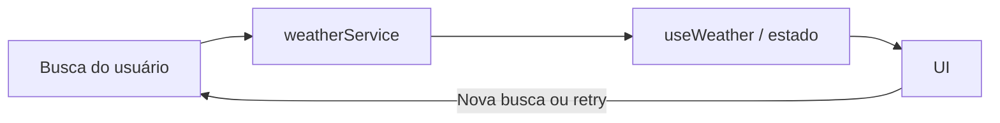

# Plano técnico — Weather App

**Status:** plano técnico derivado da especificação validada  
**Fonte da verdade:** [specs/weather-app-spec.md](../specs/weather-app-spec.md)  
**Próxima etapa:** derivar o backlog de tarefas em `tasks/`.

Este documento define arquitetura, contratos e estratégia de validação. Não especifica a implementação detalhada. As referências `FR`, `AC` e `NFR` correspondem aos identificadores da especificação.

## 1. Architecture Overview

Aplicação de página única em React, organizada em camadas. A interface não acessa a rede diretamente: o hook coordena o fluxo e o serviço encapsula as chamadas à Open-Meteo.

```text
Usuário
  └─ App / componentes de apresentação
       ├─ formulário de busca e controle de unidade
       ├─ estados de loading, vazio e erro
       └─ condições atuais e previsão
            ▲
       useWeather (estado e orquestração)
            │
       weatherService (geocoding → forecast → validação)
            │
       Open-Meteo Geocoding API / Forecast API

lib/ — conversão de temperatura, formatação e descrição dos códigos WMO
types/ — contratos compartilhados
```

- A busca manual seleciona o primeiro resultado de geocodificação e usa suas coordenadas na consulta meteorológica (FR-01, FR-02, AC-02.1).
- A camada de serviço transforma respostas externas em dados tipados e completos antes de disponibilizá-los à interface (FR-03, FR-04, AC-03.3, AC-04.4).
- O estado da consulta pertence à aplicação React; Celsius/Fahrenheit é uma preferência de apresentação separada dos dados meteorológicos (FR-05, AC-05.4).
- Componentes apresentam loading, vazio, erro ou resultado sem reproduzir lógica de rede (FR-06, FR-07).

## 2. Tech Stack

| Tecnologia | Uso e justificativa | Rastreabilidade |
|---|---|---|
| TypeScript em modo strict | Contratos explícitos para dados externos, estado e componentes; reduz o risco de apresentar respostas incompletas. | FR-02–FR-07 |
| React 19 | Composição da interface e estado local suficiente para uma aplicação sem autenticação ou persistência. | FR-01–FR-08, NFR-07 |
| Vite | Servidor de desenvolvimento e build de produção, com configuração do caminho de publicação no GitHub Pages. | FR-09, AC-09.2 |
| Tailwind CSS | Estilização responsiva consistente com o tema dark glassmorphism do projeto. | FR-08, NFR-01 |
| Open-Meteo Geocoding e Forecast | Busca de localidades e dados meteorológicos sem chave de API. | FR-02–FR-04, NFR-08 |
| Vitest e Testing Library | Testes unitários e de componentes para validações, conversões, estados e acessibilidade básica da interface. | AC-01.3, AC-03.3, AC-04.4, AC-05.*, AC-06.* |
| Playwright | Testes dos fluxos completos e da responsividade em navegador. | AC-08.*, AC-09.* |
| Biome | Lint e formatação conforme as convenções do repositório. | Qualidade de implementação |
| pnpm | Gerenciador de pacotes definido pelo projeto. | Convenção do repositório |

Não são necessários gerenciamento global de estado, roteador, backend, banco de dados ou dependências adicionais para a primeira versão: o escopo não contém rotas, contas nem persistência (NFR-07; Out of Scope).

## 3. Project Structure

```text
src/
├── components/
│   ├── states/             # LoadingState, EmptyState e ErrorState
│   ├── CurrentWeather.tsx  # Condições atuais
│   ├── ForecastCard.tsx    # Item de um dia da previsão
│   ├── ForecastList.tsx    # Lista dos cinco dias
│   ├── SearchBar.tsx       # Entrada e envio da busca
│   └── UnitToggle.tsx      # Controle Celsius/Fahrenheit
├── hooks/
│   └── useWeather.ts       # Orquestração e estado da consulta
├── lib/
│   ├── format.ts           # Formatação de datas e valores
│   ├── temperature.ts      # Conversão e arredondamento
│   └── weatherCodes.ts     # Mapeamento de códigos WMO para pt-BR
├── services/
│   └── weatherService.ts   # Geocoding, forecast, timeout e validação
├── styles/
│   └── index.css           # Estilos globais e Tailwind
├── types/
│   └── weather.ts          # Contratos compartilhados
├── App.tsx                 # Composição da tela e estado de unidade
└── main.tsx                # Inicialização React

tests/
├── unit/                   # Serviços, funções puras, hook e componentes
└── e2e/                    # Fluxos essenciais no navegador
```

A estrutura segue a arquitetura já documentada no repositório. Não se prevê camada de domínio ou abstração genérica para um único provedor (FR-02–FR-06; NFR-08).

## 4. Data Model

Os tipos abaixo são contratos conceituais; a resposta bruta da API deve ser validada antes de virar dado da aplicação. Temperaturas são mantidas em Celsius e convertidas apenas para apresentação (AC-05.4, NFR-06).

```ts
type TemperatureUnit = "celsius" | "fahrenheit";

interface City {
  name: string;
  region?: string;
  country?: string;
  latitude: number;
  longitude: number;
  timezone?: string;
}

interface WeatherCondition {
  code: number;
  description: string;
}

interface CurrentWeather {
  temperatureC: number;
  condition: WeatherCondition;
}

interface ForecastDay {
  date: string; // Data civil local no formato ISO YYYY-MM-DD
  condition: WeatherCondition;
  minTemperatureC: number;
  maxTemperatureC: number;
}

interface WeatherData {
  city: City;
  current: CurrentWeather;
  forecast: [ForecastDay, ForecastDay, ForecastDay, ForecastDay, ForecastDay];
}
```

O estado da consulta deve ser discriminado por fase, evitando combinações inválidas de flags:

```ts
type WeatherState =
  | { status: "idle" }
  | { status: "loading-geocoding"; query: string }
  | { status: "loading-forecast"; query: string; city: City }
  | { status: "empty"; query: string }
  | { status: "error"; query: string; retry: RetryContext }
  | { status: "success"; data: WeatherData };

type RetryContext =
  | { operation: "geocoding"; query: string }
  | { operation: "forecast"; query: string; city: City };
```

`WeatherData` só existe no estado de sucesso, após validar temperatura e condição atuais e todos os cinco dias. Uma tentativa de busca nova substitui o estado anterior por loading; assim, dados anteriores não aparecem como resultado da nova localidade (AC-06.4, AC-06.5, AC-07.3).

O contrato público de `useWeather` expõe `status`
(`idle | loading | success | error | empty`), `data`, `cities`, `error` e `query`,
além de `search(name)`, `selectCity(city)` e `retry()`. Ambas as fases usam
`loading` publicamente; o contexto interno de retry distingue geocodificação
de previsão. `data` é `null` fora do sucesso, e `error` contém uma mensagem
ou `null`. Entrada vazia retorna a `idle` com orientação, sem rede.
As ações durante loading são ignoradas para impedir chamadas concorrentes.
Retry repete a última etapa iniciada, inclusive após vazio ou sucesso.

## 5. Data Flow



1. A pessoa informa uma localidade. Se a entrada, após `trim`, estiver vazia, a interface orienta a correção sem chamar a API (AC-01.3).
2. O envio válido muda o estado para `loading-geocoding` e inicia uma única busca de geocodificação.
3. Sem resultados, o estado passa a `empty`; com resultados, seleciona-se o primeiro item na ordem recebida e conserva-se o contexto para exibição e retry (AC-02.1–AC-02.3, AC-06.6).
4. O serviço solicita a previsão usando latitude e longitude da mesma cidade. Durante essa etapa, o estado é `loading-forecast`.
5. O serviço valida o payload e converte códigos WMO para descrições em pt-BR. Só devolve `WeatherData` se os dados atuais e exatamente cinco datas civis consecutivas estiverem completos; caso contrário, lança erro tipado para a interface apresentar a falha, sem dados parciais (AC-03.1–AC-03.3, AC-04.1–AC-04.4).
6. No sucesso, a UI apresenta a identificação da cidade, condições atuais e cinco dias. A unidade escolhida converte e formata os valores localmente sem nova requisição (AC-05.2–AC-05.5).
7. Uma nova busca limpa o resultado anterior ao entrar em loading. Retry repete a etapa que falhou: geocodificação com a mesma busca ou forecast com a mesma cidade selecionada (AC-06.6, AC-07.1–AC-07.3).

## 6. External APIs

Todas as chamadas são feitas do serviço `weatherService`, por HTTPS, sem chave de API (NFR-08). Cada chamada individual deve ser abortada após dez segundos; não há retry automático (AC-06.7).

### Geocoding

- **Endpoint:** `GET https://geocoding-api.open-meteo.com/v1/search?name={cidade}&count=5&language=pt`
- **Parâmetros:** `name=<consulta trim>`, `count=5`, `language=pt`.
- **Uso:** selecionar o primeiro elemento de `results`, sem etapa de confirmação (FR-02, AC-02.1).
- **Mapeamento:** `name` → `City.name`, `admin1` → `City.region`, `country` → `City.country`, mais `latitude`, `longitude` e `timezone` quando presentes.
- **Sem `results` ou lista vazia:** estado vazio. Erro de rede, timeout, status HTTP não bem-sucedido ou payload inválido: estado de erro com retry da busca original (AC-02.3, AC-06.2, AC-06.3, AC-06.6).

### Forecast

- **Endpoint:** `GET https://api.open-meteo.com/v1/forecast?latitude={lat}&longitude={lon}&current=...&daily=...&timezone=auto`
- **Parâmetros:** `latitude=<lat>`, `longitude=<lon>`, `current=temperature_2m,weather_code`, `daily=weather_code,temperature_2m_max,temperature_2m_min`, `temperature_unit=celsius`, `timezone=auto` e `forecast_days=5`.
- **Uso:** `timezone=auto` faz as datas diárias corresponderem ao fuso local da cidade; `forecast_days=5` retorna hoje e os quatro dias seguintes (AC-04.1, NFR-09).
- **Mapeamento:** dados `current` para `CurrentWeather`; índices correspondentes dos arrays `daily.time`, `daily.weather_code`, `daily.temperature_2m_min` e `daily.temperature_2m_max` para cada `ForecastDay`.
- **Validação:** exigir temperatura e código atuais interpretável, cinco datas consecutivas, códigos meteorológicos com descrição e valores mínimo/máximo numéricos em cada data. Dados faltantes ou arrays desalinhados tornam a consulta inválida por inteiro (AC-03.3, AC-04.4, AC-06.5).

As descrições de condição são derivadas dos códigos WMO em uma função determinística, com textos em português do Brasil. Código sem mapeamento não deve produzir uma descrição vazia que aparente sucesso; deve ser tratado como dado inválido e seguir o fluxo de erro (NFR-05, AC-03.3, AC-04.4).

## 7. State Management

- `useWeather` mantém o estado discriminado da consulta e expõe operações para buscar e tentar novamente.
- `App` mantém `TemperatureUnit`, inicializado como Celsius. O toggle não chama o hook nem altera cidade, condição ou datas; a conversão parte sempre dos valores originais em Celsius (AC-05.1–AC-05.5, NFR-06).
- O estado é somente em memória: não persistir consultas nem unidade em armazenamento local, cookies ou URL (NFR-07).
- Enquanto qualquer chamada estiver ativa, impedir nova submissão e manter apenas uma tentativa ativa (AC-06.8). Uma busca subsequente deve retirar o sucesso anterior da apresentação (AC-07.3).
- Componentes de estado apresentam mensagens e ações explícitas. Mensagens visíveis devem estar em pt-BR e os estados devem ser anunciados por tecnologia assistiva (NFR-02, NFR-05).

## 8. Error Handling Strategy

| Situação | Comportamento | Requisito |
|---|---|---|
| Inicial / sem consulta | Estado inicial sem dados meteorológicos; busca disponível. | FR-01 |
| Entrada vazia | Não iniciar chamada e orientar a pessoa a preencher a localidade. | AC-01.3 |
| Busca ou forecast em andamento | Mostrar loading acessível; bloquear envios duplicados. | AC-06.1, AC-06.8 |
| Nenhuma localidade | Apresentar estado vazio e deixar a busca disponível. | AC-02.3, AC-06.2 |
| Falha de rede, HTTP, timeout ou payload inválido | Mensagem geral de que não foi possível obter os dados; orientação amigável específica quando conhecida; ação de retry manual; nenhum dado parcial. | AC-03.3, AC-04.4, AC-06.3–AC-06.7 |
| Nova busca após sucesso, vazio ou erro | Limpar o resultado anterior enquanto a nova consulta carrega. | AC-07.1–AC-07.3 |
| Retry após falha | Repetir a operação que falhou com a mesma busca ou cidade, sem exigir redigitação. | AC-06.6 |

Erros de domínio do serviço devem distinguir timeout, HTTP/rede e resposta inválida para facilitar testes e fornecer orientação amigável quando a causa for conhecida; a interface mantém uma mensagem geral de falha. Não usar fallback que invente temperatura, condição ou datas. Se o timeout ocorrer, abortar a chamada, inclusive durante a leitura do corpo da resposta, e liberar o estado para nova tentativa manual (AC-06.7).

O helper compartilhado de leitura JSON usa `AbortController` com limite de
10 segundos para a requisição e a leitura do corpo, e libera o timer em
`finally`. Converte `AbortError` em mensagem clara de timeout, falhas de rede
em orientação para verificar a conexão e preserva a causa original.

## 9. Testing Strategy

### Refinamentos de performance e UX

- Reutilizar uma instância de `Intl.DateTimeFormat` para datas com configuração
  fixa, evitando recriá-la para cada cartão. Não adicionar memoização React sem
  evidência de benefício.
- A região de resultados usa `aria-busy` durante a consulta; o status de
  carregamento fica fora dela para não ter seu anúncio adiado.
- Após sucesso, focar programaticamente o título da localidade com
  `tabIndex={-1}`. Trocas de unidade não disparam esse efeito.
- Preservar `aria-disabled` e a guarda de submissão da busca para manter o foco
  durante loading, mas aplicar hover apenas quando a ação estiver disponível.
- Cobrir busy, foco após busca/retry, ausência de mudança de foco na alternância
  de unidade e bloqueio de envio por clique e teclado.

### Unitários e componentes (Vitest + Testing Library)

- Testar trim e rejeição de busca vazia, sem chamada ao serviço (AC-01.3).
- Testar mapeamento da geocodificação, escolha do primeiro resultado e cidade sem campos opcionais de região/país (AC-02.1, AC-02.2).
- Testar mapeamento dos códigos WMO em pt-BR e comportamento para código desconhecido.
- Testar validação do payload meteorológico completo e incompleto, inclusive arrays com menos de cinco dias ou desalinhados (AC-03.3, AC-04.4).
- Testar conversão Celsius/Fahrenheit, arredondamento ao inteiro mais próximo e preservação dos valores-base (AC-05.2–AC-05.5, NFR-06).
- Testar transições do hook: loading, vazio, sucesso, erros nas duas etapas, retry da etapa adequada e descarte dos dados anteriores em nova busca (AC-06.*, AC-07.*).
- Testar que chamadas têm timeout de dez segundos e que submissões concorrentes não iniciam requisições duplicadas (AC-06.7, AC-06.8).
- Testar nomes acessíveis e anúncio de loading, vazio e erro nos componentes de estado (NFR-02).

### E2E (Playwright)

- Fluxo de busca com resultados, identificação da cidade, condições atuais e cinco dias.
- Busca sem resultados, falha com retry, nova busca e garantia de que o resultado anterior não é apresentado como novo.
- Alternância C/°F, verificando unidade ativa e ausência de uma nova consulta meteorológica.
- Operação por teclado, foco visível e mensagens de estado acessíveis.
- Layout sem rolagem horizontal em 320, 768 e 1280 pixels CSS; executar os fluxos nos navegadores/plataformas definidos em NFR-04 quando a infraestrutura de CI permitir.
- Verificar o build publicado no caminho do GitHub Pages e a disponibilidade dos recursos nesse caminho (AC-09.1, AC-09.2).
- Medir LCP ≤ 2,5 s e CLS ≤ 0,1 em auditoria Lighthouse móvel do build de produção; excluir latência da API, conforme NFR-03.

## 10. Risks & Trade-offs

| Risco / trade-off | Decisão ou mitigação | Rastreabilidade |
|---|---|---|
| Primeiro resultado pode não ser a localidade pretendida quando houver homônimos. | Manter a regra explícita da spec e identificar cidade, região e país quando disponíveis; sem seletor adicional. | FR-02, AC-02.1–AC-02.2 |
| Open-Meteo pode estar indisponível, limitado ou não cobrir a localidade. | Timeout, erro claro e retry manual; validar limites e condições de uso antes da publicação. | AC-06.3–AC-06.7, NFR-08 |
| Um único dado ausente impede a tela completa. | Validar tudo no serviço e rejeitar o resultado inteiro em vez de exibir previsão parcial. | AC-03.3, AC-04.4, AC-06.5 |
| Conversão ou arredondamento incorreto pode distorcer valores. | Conservar Celsius como valor-base, converter apenas na apresentação e testar fórmula e arredondamento. | AC-05.4, NFR-06 |
| `timezone=auto` depende da zona horária informada pelo serviço. | Usar timezone associado às coordenadas e preservar datas ISO civis sem convertê-las pelo fuso do dispositivo. | AC-04.1, NFR-09 |
| A publicação sob subcaminho do Pages pode quebrar assets ou rotas. | Configurar o `base` do Vite para o caminho de publicação e verificar o build servido nesse caminho; não adicionar roteador sem necessidade. | FR-09, AC-09.2 |
| A matriz de navegadores e dispositivos é ampla. | Automatizar fluxos essenciais com Playwright e complementar com validação manual nos navegadores/plataformas especificados. | AC-08.6–AC-08.7, NFR-04 |
| O escopo não prevê cache nem persistência. | Manter a implementação simples e em memória; repetir chamadas apenas por ação explícita do usuário. | NFR-07, Assumptions |

## Rastreabilidade resumida

| Requisito | Elementos do plano |
|---|---|
| FR-01 / US-01 | `SearchBar`, validação da entrada, serviço de geocodificação e testes de busca. |
| FR-02 / US-02 | `City`, seleção do primeiro resultado, identificação na UI e testes do mapeamento. |
| FR-03 / US-03 | `CurrentWeather`, parâmetros `current`, validação integral e apresentação. |
| FR-04 / US-04 | `ForecastDay`, cinco datas locais, parâmetros `daily` e validação dos cinco dias. |
| FR-05 / US-05 | `TemperatureUnit`, Celsius-base, conversão local e testes sem nova chamada. |
| FR-06 / US-06 | Estados discriminados, timeout, mensagens, retry manual e anúncios acessíveis. |
| FR-07 / US-07 | Nova busca limpa estado anterior; busca e retry mantêm contextos distintos. |
| FR-08 / US-08 | Componentes responsivos, teclado, WCAG 2.2 AA, breakpoints e matriz de navegadores. |
| FR-09 / US-09 | Configuração do base path do Vite, build e verificação no GitHub Pages. |
| NFR-01–NFR-09 | Responsividade, acessibilidade, Lighthouse, compatibilidade, idioma, unidades, privacidade, API e timezone/localidade tratados nas seções acima. |
